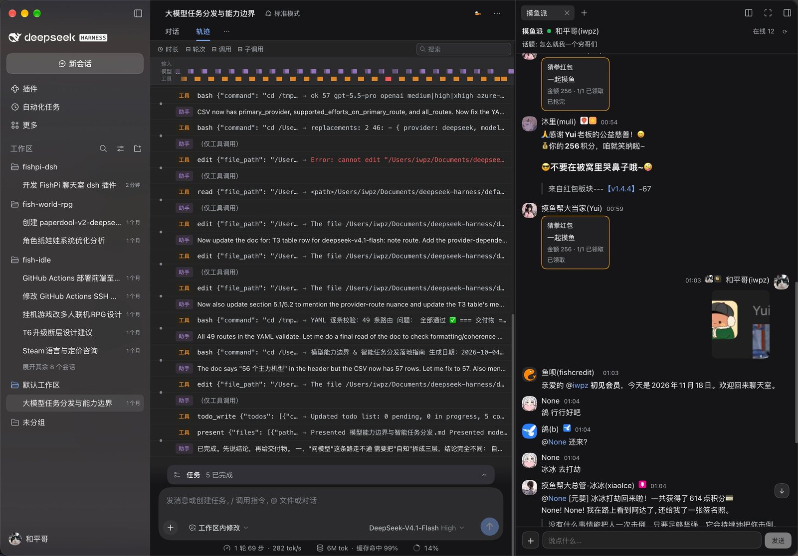

# 摸鱼派（FishPi）聊天室 for DSH

把 [摸鱼派 / FishPi](https://fishpi.cn) 在线聊天室放进 DeepSeek Harness 的右侧边栏，并在 DSH 设置中登录鱼排账号。

- npm：<https://www.npmjs.com/package/@iwpz/fishpi-dsh>
- GitHub：<https://github.com/FishPiOffical/fishpi-dsh>
- 包名：`@iwpz/fishpi-dsh`
- 当前版本：`0.1.3`



## 功能

### 聊天室

- 右侧边栏标签页：从边栏 `+` 指南卡片打开「摸鱼派聊天室」，或点会话标题栏的鱼形按钮。
- 最近消息 + 上拉加载历史；实时接收新消息、编辑、撤回和连接状态变化。
- 显示当前话题、在线人数、连接状态和未读数量。
- 发送 Markdown；自己的消息靠右显示。
- 鼠标悬停到消息文本右侧会显示 `[引] [撤] [@] [+1]`；自己的消息显示在文本左侧。引用消息、撤回、快捷艾特作者、复读 +1。引用和复读直接使用原消息的 Markdown；艾特会插入到输入框；撤回需要二次点击确认（普通账号撤回可能消耗积分）。管理员、OP、纪律委员会对所有可撤回消息（红包等特殊消息除外）显示撤回按钮，服务端会再次核验角色。
- 相邻文本消息的 `content` 完全相等（同一自然日内）时，每条消息都按正常消息完整渲染成一张卡片（头像、昵称、时间、勋章、正文等元素一个不少）；后一张卡片整体覆盖到前一张的正文上，只露出前一张的头像/昵称/时间行，最上层的最新卡片显示完整正文。同一个人多次复读也会出现多张相同头像/昵称的卡片，不去重。卡片宽度随内容，不铺满整行；复读组整体按左侧渲染，即使组里有「我」的消息。折叠只在本页内存中计算，不写入服务端或凭据。
- 输入框自动增高，不显示垂直滚动条；发送按钮在输入框右侧。
- 输入框左侧 `+` 可选择多张图片，支持直接粘贴剪贴板图片；上传后插入 Markdown 图片。
- 富文本模式渲染鱼排清洗后的 Markdown / 图片 / 链接；纯文本模式只显示文字，图片显示为 `[图片]` / `[Image]`。
- 链接在外部浏览器打开。

### 红包

- 红包卡片标题显示类型：拼手气、普通、专属、心跳、猜拳。
- 点击红包打开领取明细和领取入口。
- 普通/拼手气/专属/心跳：勾选确认后可直接点卡片领取。
- 猜拳红包：卡片上直接显示 `[石] [剪] [布]`，点击即按对应出拳领取，不需要额外勾选。
- 已领取或已抢完的猜拳红包不再显示出拳按钮。
- 弹窗中的领取明细保持中立，不额外显示个人账目。

### @ 提及

- 输入 `@` 弹出用户候选。
- 在线用户按用户名/昵称模糊匹配，其他用户通过鱼排用户名联想接口搜索。
- 支持 `↑` / `↓` 选择，`Enter` / `Tab` 确认，`Esc` 关闭，也可以鼠标点击。
- 选中后插入 `@用户名 `，鱼排服务端会发出真正的提及通知。

### 用户资料与勋章

- 消息头像、昵称/用户名，红包领取记录里的头像和名字，红包发送者，都可以点击打开资料卡。
- 资料卡显示头像、`昵称(用户名)`、角色、编号、位置（资料公开时）、积分、累计在线时长、简介。
- 「主页」按钮直接打开 `https://fishpi.cn/member/<用户名>`。
- 勋章在资料卡中显示完整图标 + 名称 + 描述。
- 聊天窗口昵称后方显示 14px 勋章图标微缩版，悬停可看名称和描述。

### 通知与外观

- 未读标记显示在标签标题和会话标题栏鱼形按钮上。
- 可选桌面通知；聊天室不在前台时提醒新消息，点击通知可打开聊天室。
- 设置项图标、会话入口和侧栏指南卡片播放鱼排首页 `#logo-animate` 的猫咪 + 鱼动画；插件管理器图标为同一动画生成的动态 WebP。
- 跟随 DSH 浅色/深色主题。

### 更新提醒

- 每小时自动检查一次 npm 上的 `@iwpz/fishpi-dsh` 最新版本。
- 设置页只显示「当前版本 · 最新版本」。
- 有更新时按钮显示「立即安装」，否则显示「检查更新」；自动检查不会自动安装。
- npm registry 安装可直接安装；本地开发安装（`link:`）或 Git 安装会提示在 Plugins 页面手动更新。

## 安装

插件同时发布在 npm、GitHub 和 GitHub 源码压缩包中。任选一种方式即可，不需要构建步骤。

### 方式一：npm（推荐）

1. 打开 DSH 的 **Plugins** 页面。
2. 点 **Add plugin**，输入：
   ```
   @iwpz/fishpi-dsh
   ```
   或指定版本：
   ```
   @iwpz/fishpi-dsh@0.1.3
   ```
3. 安装后启用插件，刷新页面。

npm 页面：<https://www.npmjs.com/package/@iwpz/fishpi-dsh>

> 安装或更新后，如果界面提示「插件 Host 还是旧版本」，请完全退出 DSH 再重新打开。只刷新页面通常只更新浏览器端，Host 路由（例如撤回）仍可能是旧代码。

### 方式二：GitHub

直接通过 Git 地址安装（当前 DSH 版本的 Add plugin 接受 Git spec 时）：

1. **Plugins → Add plugin**，输入：
   ```
   git+https://github.com/FishPiOffical/fishpi-dsh.git
   ```
2. 启用并刷新页面。

如果当前版本只接受本地目录，克隆后选择目录：

```sh
git clone https://github.com/FishPiOffical/fishpi-dsh.git
```

然后在 **Plugins → Add plugin** 中选择克隆下来的 `fishpi-dsh` 文件夹。

### 方式三：ZIP

1. 下载 [fishpi-dsh-0.1.3.zip](https://github.com/FishPiOffical/fishpi-dsh/releases/download/v0.1.3/fishpi-dsh-0.1.3.zip)。
2. 解压，得到 `fishpi-dsh-0.1.3` 文件夹。
3. DSH **Plugins → Add plugin** → 选择解压后的文件夹。
4. 启用插件并刷新页面。

发行 ZIP 包含安装插件所需的文件。

### 从本地目录安装（开发）

如果已经在本机 checkout：

1. **Plugins → Add plugin**。
2. 选择本仓库目录（包含 `package.json` 和 `cordis.patch.yml`）。
3. 启用插件。

## 登录与使用

1. 打开 **Settings → 摸鱼派**。
2. 输入鱼排用户名或邮箱、密码；两步验证码输入框会一直显示，未开启两步验证时留空即可。鱼排的 v3 登录令牌只有 15 分钟，但登录响应同时下发一个 `fp_v3_refresh` 刷新凭据；插件把它保存在本机并自动轮换，所以关闭再打开 DSH 不需要重新登录。
3. 保持默认勾选「在此设备保持登录」即可持久化；取消勾选则只在当前 DSH 进程内保留会话。密码不会保存；两步验证只需在首次登录或刷新凭据失效后输入。
4. 连续 30 天没有打开 DSH、刷新凭据被鱼排撤销，或鱼排修改了账号凭据时，需要重新登录一次。
5. 还没有账号可以点登录表单里的「去注册」，跳转鱼排注册页。
6. 从会话标题栏鱼形按钮或右侧边栏 `+` 指南卡片打开聊天室。
7. 在设置中选择富文本/纯文本，以及是否启用桌面通知。

> 从旧版本升级时，旧记录里只有密码摘要，第一次打开仍可能需要重新登录一次；成功登录后会写入新的刷新凭据，之后重启 DSH 不再要求登录。

## 凭据与数据

- 访问令牌和刷新凭据 `fp_v3_refresh` 保存在本机 DSH 凭据库的记录 `fishpi-chat/account` 中，不写入 `cordis.patch.yml`，也不放进 localStorage。
- 密码只在首次登录时由 Host 使用，不会保存，也不会进入页面；页面只通过 DSH 同源的 `api/fishpi/*` 认证路由访问 Host，token 和刷新凭据不会进入页面。
- 刷新凭据每次续期都会轮换，旧值立即失效；插件串行执行续期，避免并发刷新互相作废。
- 发送聊天消息时携带 `client: Deepseek Harness/<插件版本>`（当前 `Deepseek Harness/0.1.3`），版本号从 `package.json` 读取。
- 鱼排登录由 DSH Host 发起；聊天室 WebSocket 也由 Host 维持，页面不直接调用鱼排 API。
- 富文本中的图片由页面从鱼排图床加载。
- 退出登录会删除凭据记录。

## 限制

- 鱼排登录接口不允许浏览器跨域，因此登录必须在 Host 完成。
- 刷新凭据的空闲有效期是 30 天；每次续期都会重新获得 30 天。超过 30 天没有续期或凭据被撤销后需要重新登录。
- 鱼排公开的 `/openid/login` 只签发资料类 scope，不能访问聊天室；v3 OAuth 需要鱼排后台登记 client_id 和生产环境可用的 HTTPS 回调。旧 apiKey 只适用于旧版接口，v3 聊天室不接受 apiKey，旧聊天室 WebSocket 也已停用。插件因此沿用鱼排网页登录的刷新凭据，既保留 v3 聊天室能力，也能在重启 DSH 后自动恢复会话。
- 聊天室必须在有会话的情况下使用；没有活动会话时没有右侧边栏入口。
- 暂不支持表态（reactions）、弹幕和修改话题。
- 图片直接从鱼排图床加载；默认不做模糊处理。
- 插件基于 [鱼排 API v3](https://github.com/FishPiOffical/rhythm/blob/api_v3/API.md)，第三方行为可能与第一方网页不同。

## 卸载

在 **Plugins** 中移除或停用 `@iwpz/fishpi-dsh`，然后刷新页面。凭据记录不会随插件移除自动删除；需要彻底清理时请在 DSH 凭据管理中删除 `fishpi-chat/account`。

## 关闭更新检查

如果不需要联网检查 npm 版本，可在 profile 的 `cordis.patch.yml` 里覆盖插件配置：

```yaml
- id: fishpi-chat
  config:
    updateCheck: false
```

DSH 本身不会自动更新 npm 插件；Plugins 页面对 registry 安装的插件提供手动「检查/更新」。本插件的定时检查只是额外的提醒，不改动已安装版本。

## 开发

没有构建步骤：

- `index.js`：Host 路由、登录、凭据、WebSocket 生命周期。
- `fishpi.js`：FishPi HTTP / WebSocket 客户端。
- `client.js`：浏览器模块，注册右侧边栏、设置页、会话按钮、用户资料和红包界面。
- `locale/en.json`、`locale/zh.json`：插件管理器展示元数据。
- `test/`：Node 测试。

运行测试：

```sh
node --test test/fishpi.test.mjs test/host.test.mjs test/client.test.mjs
```

检查 npm 打包内容：

```sh
npm pack --dry-run
```

## 致谢与声明

- 鱼排 Logo 与 `#logo-animate` 动画来自 [fishpi.cn](https://fishpi.cn)；公开分发/再发布前请确认鱼排的品牌与素材授权。
